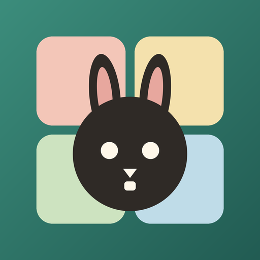
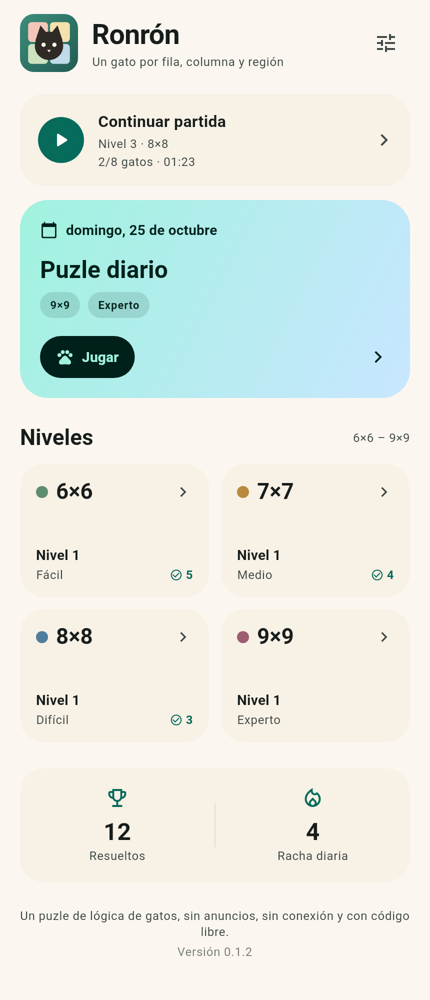
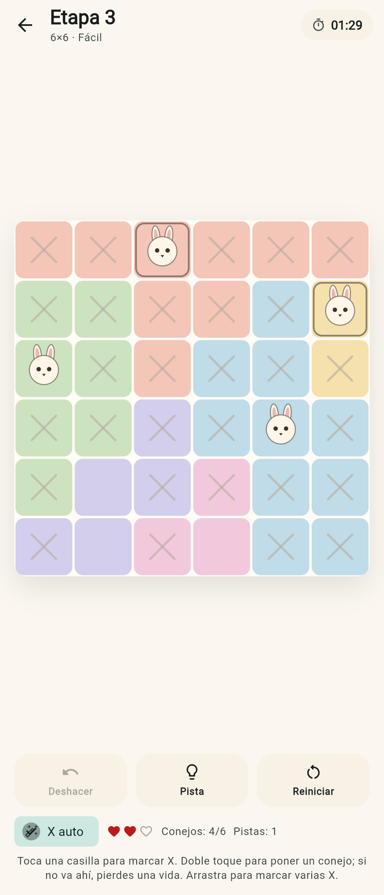
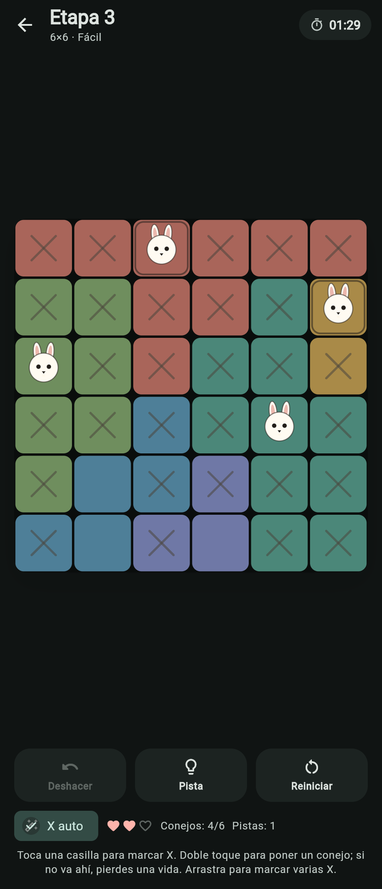
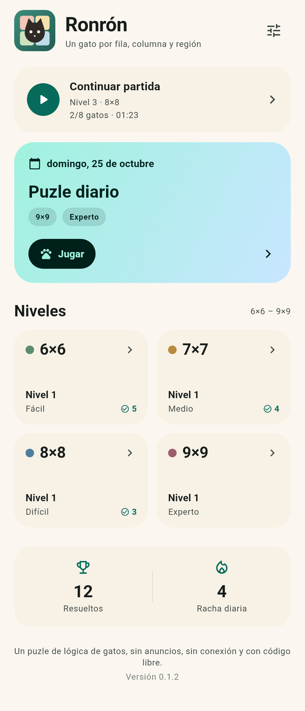

# Ronrón

**Puzle de lógica de gatos para Android, libre, sin anuncios y sin conexión.**

Ronrón es un juego de deducción sobre una cuadrícula dividida en regiones de
color. Hay que colocar exactamente un gato en cada fila, en cada columna y en
cada región, sin que dos gatos se toquen, ni siquiera en diagonal.

<p align="center">
  
</p>

<p align="center">
  
  
</p>
<p align="center">
  
  
</p>

## Descargar

La versión de prueba está en
[Releases](https://github.com/sasogu/ronron/releases):

- APK universal firmado: `ronron-0.1.2.apk`
- Requiere Android 7.0 o posterior.
- Instalación manual: descarga el APK y permite la instalación desde el
  navegador o el gestor de archivos. También se puede instalar con
  `adb install ronron-0.1.2.apk`.

La aplicación no pide permisos, no usa Internet y guarda todo en el propio
dispositivo.

## Cómo se juega

- **Un toque** sobre una casilla vacía marca una X (casilla descartada). Otro
  toque borra la X.
- **Doble toque** coloca un gato. Si la casilla ya tiene un gato, el doble
  toque lo quita.
- **Arrastra** el dedo para marcar varias X seguidas.
- Los gatos que se molestan entre sí (misma fila, columna, región o contacto
  diagonal) se resaltan en rojo.
- **X auto** marca automáticamente las casillas que ya no pueden tener gato.
- **Pista** coloca un gato correcto; **Deshacer** revierte el último cambio y
  **Reiniciar** limpia el tablero.

## Características

- 399 puzles originales verificados con **solución única**: 99 de 6×6, 100 de
  7×7, 100 de 8×8 y 100 de 9×9.
- Regiones irregulares, desde casillas pequeñas hasta formas alargadas, como
  en los puzles de este género.
- **Puzle diario** con tamaño rotativo, racha de días y progreso guardado.
- **Niveles sin fin** por tamaño, con progreso por nivel.
- Guardado automático de la partida en curso y del cronómetro.
- Interfaz en **castellano y valenciano**.
- Tema **claro, oscuro o según el sistema**.
- Sin anuncios, sin compras, sin cuentas, sin telemetría y sin conexión.
- Código y puzles libres (GPL-3.0).

## Desarrollo

Requisitos: Flutter 3.35 o posterior, Dart 3.9 y Android SDK 35 o posterior.

```bash
flutter pub get
flutter analyze
flutter test
flutter build apk --release
```

El APK resultante queda en `build/app/outputs/flutter-apk/app-release.apk`.

Para firmar una versión de publicación se usa `android/key.properties` junto
con un almacén `android/app/ronron-release.jks`. Ambos están excluidos de Git.
Sin ese fichero, Gradle firma la versión release con la clave de depuración.

### Estructura

```
lib/
  app.dart                 MaterialApp, tema e idiomas
  app_state.dart           ajustes, estadísticas y partida guardada
  data/game_store.dart     persistencia con shared_preferences
  data/puzzle_repository.dart  carga del lote de puzles
  game/puzzle.dart         modelo del puzle
  game/generator.dart      generador de puzles con solución única
  game/solver.dart         solver exacto y solver humano
  game/game_controller.dart  estado de la partida
  ui/                      portada, tablero, partida y ajustes
assets/puzzles.json        lote verificado de puzles
tool/                      generación y verificación del lote
test/                      pruebas de lógica, controlador e interfaz
```

### Generación de puzles

Los puzles no se generan en el móvil: viajan verificados dentro del APK. El
generador parte de una solución válida y reparte las casillas entre regiones
vecinas comprobando, después de cada asignación, que la solución sigue siendo
única. Las regiones son siempre conexas y cada una contiene exactamente un
gato. Después se filtran tamaños extremos y se vuelve a comprobar la unicidad
con el solver exacto.

```bash
# Generar un bloque de puzles de un tamaño
dart run tool/gen_range.dart 8 0 50 /tmp/pool-8.json

# Verificar assets/puzzles.json (regiones conexas, solución única)
dart run tool/verify_pool.dart
```

Las pruebas del proyecto validan los 399 puzles del lote, además del
generador, el controlador de partida y la interfaz.

## Privacidad

Ronrón funciona completamente sin conexión. No incluye el permiso de Internet
en el APK de publicación, no crea cuentas y no envía datos a ningún servidor.
El progreso se guarda localmente con `shared_preferences`.

## Créditos y alcance

El tipo de puzle (una pieza por fila, columna y región, sin contacto) es un
género clásico conocido como *Queens* o *Star Battle*. Este proyecto se inspira
en esa mecánica y en la popularidad de Meowdoku, pero **no está afiliado,
patrocinado ni asociado** con Meowdoku ni con Oakever Games, y no incluye
material, nombres, niveles ni imágenes del juego original. El nombre Ronrón,
el icono, el arte del gato, los puzles y el código son originales.

## Licencia

Copyright © 2026 Samuel Soriano.

Este programa es software libre: puedes redistribuirlo y modificarlo bajo los
términos de la **GNU General Public License, versión 3 o posterior**. Consulta
[LICENSE](LICENSE).

---

## English summary

Ronrón is a free, offline, ad-free cat logic puzzle for Android. Place one cat
in every row, column and colored region without touching, not even diagonally.
Includes 399 original uniquely-solvable puzzles, a rotating daily puzzle,
endless levels, Spanish/Valencian UI, dark mode, autosave and hints. Built with
Flutter. Not affiliated with Meowdoku. Licensed under GPL-3.0-or-later.
